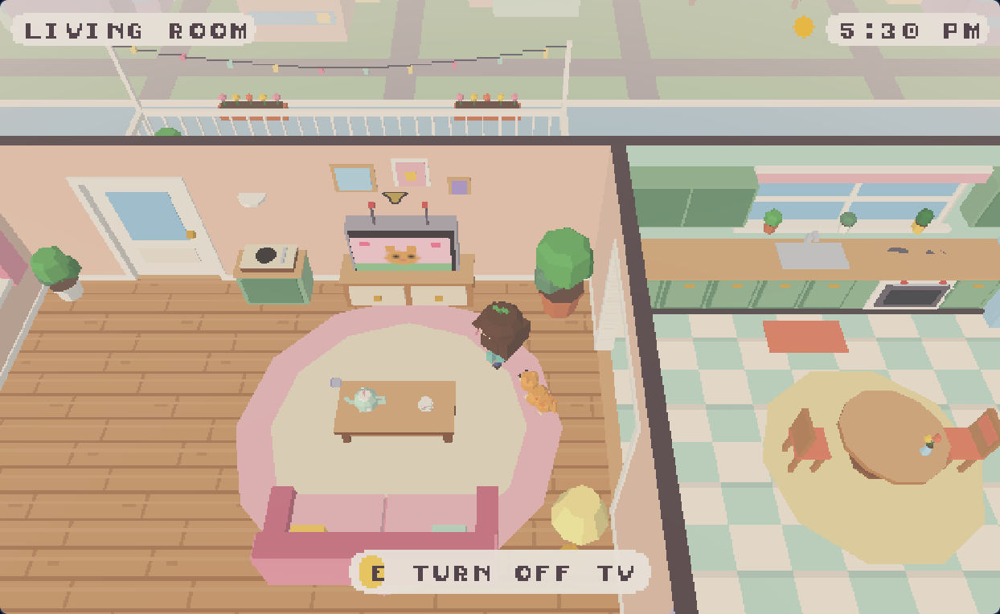
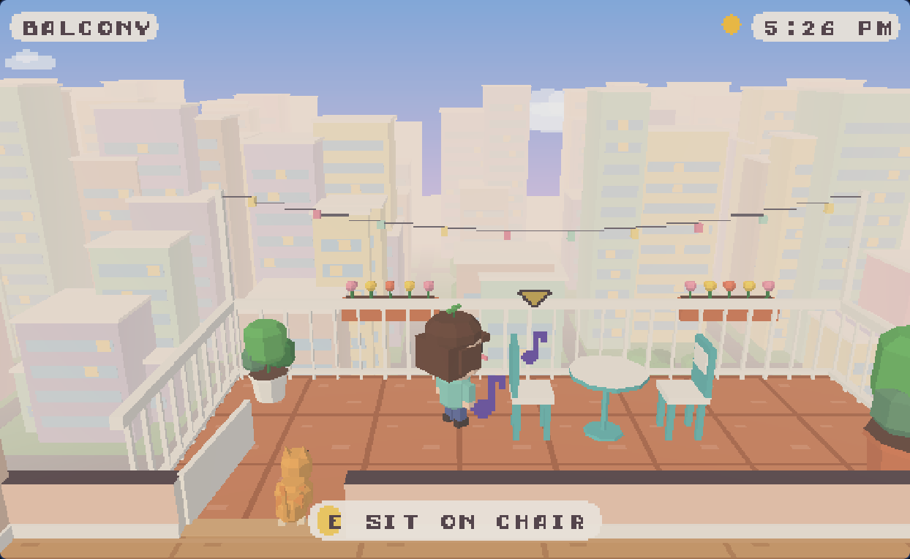
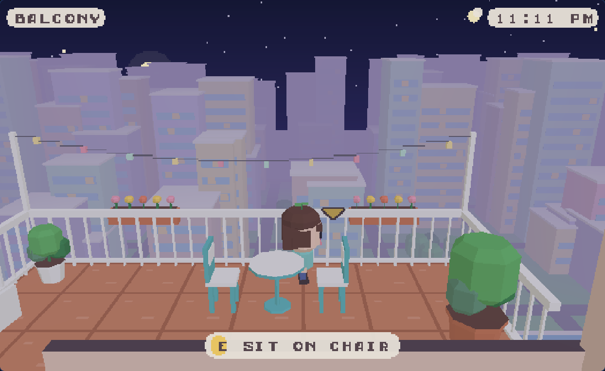
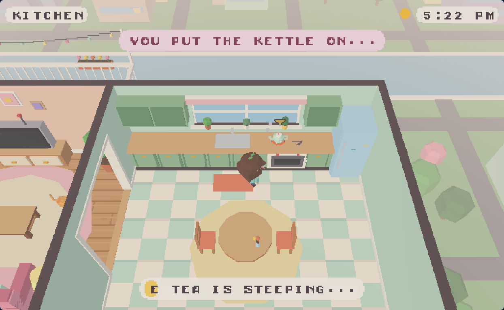
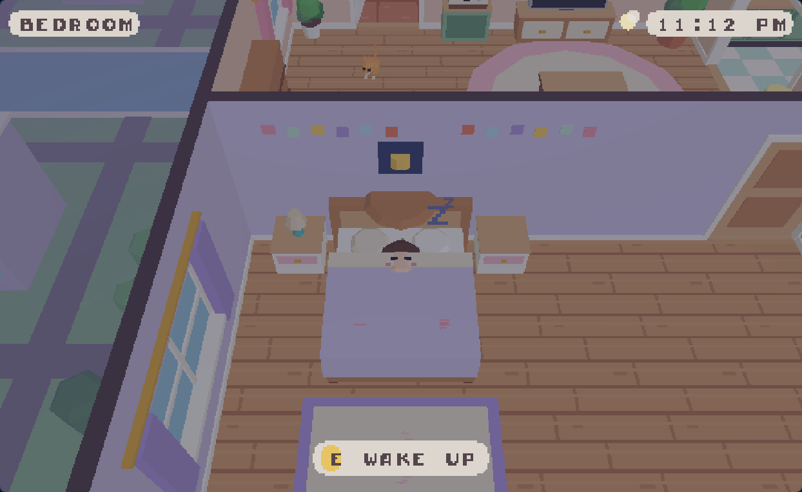

# Roomer

A small, cozy apartment to potter around in, made with the
[Petrichor64](https://github.com/Auxnon/Petrichor64) fantasy console. There's no goal.
You can brew tea, carry the pot around, watch TV, nap, play a record, water the plants,
pet the cat, and step out onto the balcony to look over the city.



| | |
|---|---|
|  |  |
|  |  |

## Playing

```sh
petrichor64 path/to/roomer
```

Build the engine with `--features audio` if you want sound (blips, the kettle, Mochi's
purr and the record player's tune). Without audio the game is silent but otherwise
the same.

| Input | Does |
|---|---|
| WASD / arrow keys | walk |
| click the floor | walk there (doors open themselves on the way) |
| E / Enter, or click a thing | use it (if it's far away, you walk over first) |
| T while on the couch | TV remote |
| mouse wheel | zoom |

## Things to do

- **Tea.** The teapot starts on the stove. Press E at the stove to brew it. When it
  whistles, pick it up and set it on any table: the coffee table, the kitchen table,
  the counter, the nightstand, the entry side table or the bistro table on the balcony.
  You pour a cup each time (three per pot). You can sip a cup and then tidy it away.
  Put the pot back on the stove to brew more.
- **Couch and chairs.** Sit on the couch, the armchair, the bench or any chair. From
  the couch you can click the TV, the lamps or the record player without getting up.
- **TV.** There are four channels: a cat show, the seaside, colour bars and a cooking
  show. They rotate while you watch.
- **Bed.** Lie down. If you stay a few seconds you doze off and the day turns to night,
  or back again.
- **Doors.** The bedroom, kitchen and balcony doors open and close. The front door
  stays shut. It's a stay-in day.
- **Balcony.** The camera drops low so you can see the skyline, string lights and
  flower boxes.
- **Also:** lamps, the record player, plants to water, the fridge, the sink, the
  wardrobe, the bookshelf, and Mochi the cat, who naps around the flat and likes pets.

Walls between you and the camera drop to a low cutaway, The Sims style, so you can
always see the room you're in.

## How it's built

All of it is code: there are no model or texture files. Furniture is made from
flat-coloured boxes, prisms and discs (`scripts/mesh.lua`) that all sample one 64-colour
palette texture (`scripts/pal.lua`). Floors, the TV shows and the particle sprites are
painted into small textures at startup (`scripts/tex.lua`). The sky is painted onto the
engine's sky raster.

| File | What's in it |
|---|---|
| `main.lua` | startup, the frame loop, camera, mouse picking, keys |
| `shell.lua`, `doors.lua` | floors, walls with openings, cutaway walls, swinging doors |
| `furn_*.lua` | the furniture in each room |
| `props.lua` | surfaces, wall decor, and the teapot, cup, player and cat models |
| `world.lua` | collision footprints, grid pathfinding (BFS on a 0.25 grid), interactables |
| `player.lua`, `cat.lua` | movement, poses and animation; Mochi's wandering |
| `play.lua` | what each interaction does, the tea state machine, the TV |
| `env.lua` | day and night, the sky, the city below |
| `ui.lua`, `fx.lua`, `sfx.lua` | HUD, particle pool, sound and the record's song |

Petrichor64's Lua VM (silt) has a few known miscompiles, listed in the engine's
`SILT-BUGS.md`. The code here works around them:

- Call results are stored in locals before they're passed to another call.
- A table constructor that contains locals is always written as its own
  `local t = {...}` statement.
- There are no anonymous functions.
- Nothing is ever removed from a table.

### Playtests

`playtests/` has scripted runs that drive the game through the same functions that
input uses. Each file defines `TEST_HOOK(dt)`, which `main.lua` calls every frame.

```sh
playtests/run.sh playtests/soak.lua path/to/petrichor64
```
